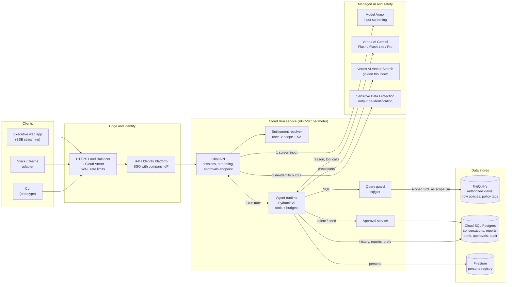
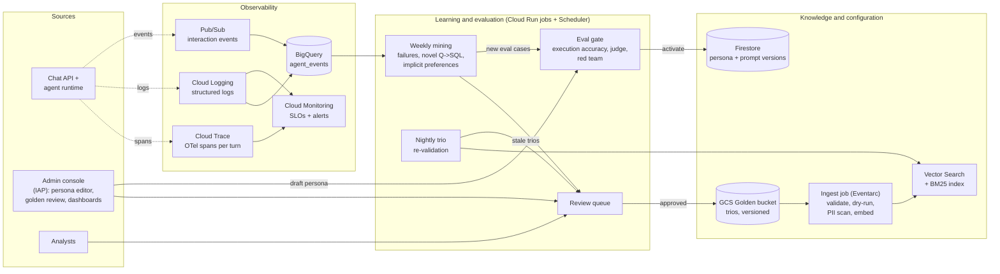
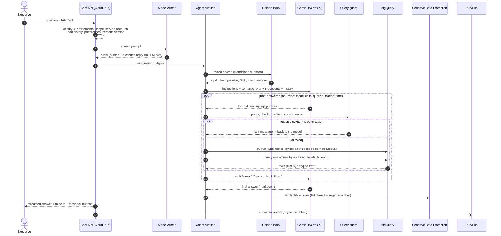
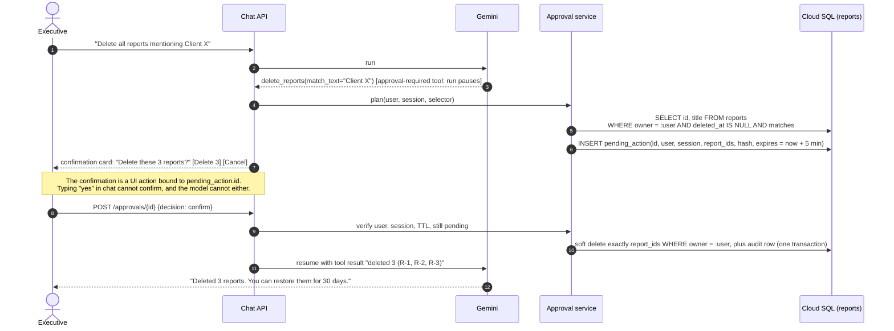
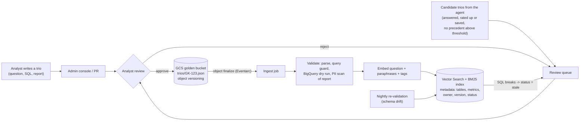
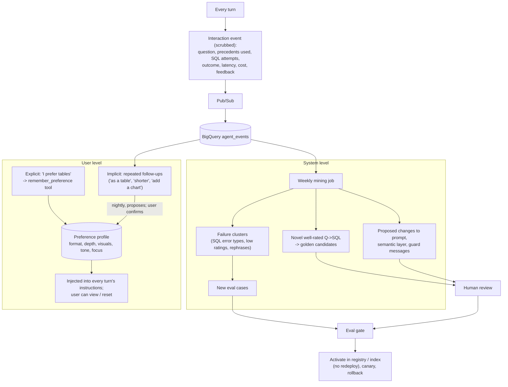

# High-Level Design: Retail Data Analyst

Production design for a data analysis chat agent used by the retail company's executive teams.
Companion documents: [technical-design.md](technical-design.md) (how each requirement is met,
error handling, evaluation) and the [README](../README.md) (prototype, setup, example run).

## 1. Goals and assumptions

**Goals.** Executives ask analytical questions in plain English ("Why are users in state X
underspending vs Y?", "Why did churn spike last month?", "Create a Q1 report with actions for
Q2"), follow up conversationally, and receive correct, explained, actionable answers and
reports. The system must:

- never expose PII;
- only let each user analyse their own products;
- never run a destructive action without explicit confirmation;
- degrade gracefully;
- be observable;
- improve over time;
- let non-developers change its tone weekly.

**Assumptions.** These are the questions raised with OpsFleet. A3 and A4 were confirmed by OpsFleet; the rest are defaults until answered.

| # | Topic | Assumption |
|---|---|---|
| A1 | Cloud | GCP: the data is in BigQuery and Gemini is preferred. Single region (EU or US to match the data). |
| A2 | Identity | Company SSO via an OIDC/SAML IdP (Google Workspace, Okta or Entra), federated into GCP. |
| A3 | Entitlements | **Confirmed:** each manager analyses only their own brands; the CEO sees everything. Customer and order data are visible only through purchases of in-scope products. The manager-to-brands mapping is ours to define: a config file in the prototype, an access table in production. (The model also supports category and department scopes.) |
| A4 | PII | **Confirmed:** first name, last name, email, street address, postal code and exact coordinates never appear in output or reach the LLM. City, state, country, age, gender and traffic source only in aggregates. Customers are referenced by `user_id` or a stable salted-hash pseudonym. We add a minimum group size of 5 in production. |
| A5 | LLM data handling | Raw PII must not be sent to the LLM provider, even under enterprise terms. |
| A6 | Definitions | Revenue excludes Cancelled and Returned lines. Churn = no order within 90 days. Calendar quarters. All held in the semantic layer, owned by the data team. |
| A7 | Golden bucket | JSON trios in GCS, curated by an analyst team that can review agent-proposed candidates. |
| A8 | Reports | Private to their owner by default (sharing is an extension). Soft delete with a 30-day restore window satisfies "strict confirmation". |
| A9 | Scale | Tens to low hundreds of executives, peak ~20 concurrent conversations, first token < 3 s, typical answer < 30 s. |
| A10 | Front end | Web app first (SSE streaming); Slack/Teams are adapters over the same API. The prototype is a CLI. |
| A11 | Retention | Conversations and traces 90 days, audit log 2 years, preferences until the user resets them. |
| A12 | Language | English. |

## 2. Architecture

### 2a. Online request path

Numbered edges follow one question: the input is screened, the agent runs the turn (retrieving precedents, calling Gemini, and querying BigQuery only through the query guard with the scope's service account), then the output is de-identified. Destructive or outward-facing tool calls go through the approval service (§4).

### 2b. Knowledge, observability and learning (asynchronous)

### Building blocks

| Block | Service | Why this service |
|---|---|---|
| Edge | External HTTPS Load Balancer + **Cloud Armor** | TLS, WAF rules, per-IP and per-user rate limits before anything costs money. |
| Identity | **IAP** or **Identity Platform**, federated to the company IdP | SSO with no passwords stored. IAP passes a signed JWT with the user's identity and groups to the API. |
| Chat API + agent runtime | **Cloud Run** (one service; agent in-process) | Scales to zero between working hours, handles streaming (SSE) and long requests (up to 60 min), per-request concurrency, no cluster to run. Min instances = 1 in business hours to avoid cold starts. |
| Agent framework | **Pydantic AI** | Approval-required tools, retry/terminal tool errors, usage limits, fallback models, typed dependency injection, OpenTelemetry GenAI spans. Model-agnostic. See the README for alternatives. |
| LLM | **Gemini on Vertex AI**: Flash as workhorse, Flash-Lite for fallback and cheap classification, Pro for long reports and as the eval judge | Strong tool calling and long context at Flash prices and latency. Vertex rather than AI Studio for production: regional processing, VPC-SC, IAM, enterprise data terms (no training on prompts), provisioned throughput. Pinned model versions; upgrades only through the eval gate (§7). |
| Warehouse | **BigQuery** | The data is there. Dry runs give free validation and cost estimates. `maximum_bytes_billed` hard-caps cost. Authorized views, row access policies and column policy tags enforce entitlements and PII in the database itself, independently of our code. |
| Query guard | In-process library (**sqlglot**) | Deterministic, microseconds, testable. Rejects non-SELECT and non-allowlisted access, rewrites to scoped views, and returns "fix-it" messages the model can act on. |
| Golden knowledge | **GCS** bucket (source of truth) + **Vertex AI Vector Search** (or AlloyDB/pgvector at this scale) + Embeddings API | GCS: cheap, versioned, event-driven, and analysts can use it directly. A vector index for semantic recall; BM25 kept alongside for exact terms (state names, metric names). |
| App state | **Cloud SQL for PostgreSQL** | Relational data with transactions (reports, pending approvals, audit log, preferences, conversations); point-in-time recovery; row ownership enforced in every query. |
| Persona / prompt registry | **Firestore** + admin console | Small versioned documents, real-time reads, edited through a form, with no deploy. |
| Safety services | **Model Armor** (input), **Sensitive Data Protection** (output, logs) | Managed detectors (prompt injection, jailbreak, ~150 PII infoTypes) that security can tune without a release. Our deterministic controls stay as the floor. |
| Async work | **Pub/Sub** + **Cloud Run jobs** + **Cloud Scheduler** | Interaction events, golden ingestion (Eventarc on bucket writes), nightly re-validation, evals, learning-loop mining. |
| Observability | **OpenTelemetry** -> **Cloud Trace**, **Cloud Logging** -> BigQuery sink, **Cloud Monitoring** | One trace per turn with every model call and tool call. Logs in BigQuery for analysis. SLO-based alerting. (Langfuse or Logfire can read the same OTLP spans if the team prefers an LLM-specific UI.) |
| Secrets | **Secret Manager** | No keys in code or images. With Vertex AI, Gemini needs no API key at all (service account auth). |

## 3. Request flow: an analysis question

## 4. Request flow: destructive action

## 5. Golden Knowledge lifecycle

## 6. Learning loops

## 7. Deployment and environments

- **Environments:** dev, staging and prod projects. Each has its own Cloud SQL, Firestore,
  bucket and service accounts. Staging reads a masked copy of production data.
- **CI/CD:** Cloud Build or GitHub Actions. Unit and red-team tests and golden-trio validation
  run on every PR. The offline eval suite (§8 of the technical design) runs on staging before
  promotion. Container images go to Artifact Registry. Cloud Run revisions roll out as a
  canary (10% -> 50% -> 100%) and roll back automatically on SLO burn.
- **Config without deploys:** persona, prompt versions, model choice, budgets and feature flags
  live in the registry (Firestore) and are read per request (cached for 30 s).
- **Network:** a VPC Service Controls perimeter around BigQuery, Cloud SQL, GCS and Vertex AI,
  so a leaked credential cannot exfiltrate data from outside it. Private connectivity to Cloud
  SQL.

## 8. Data stores: what is stored where

| Data | Store | Contains PII? | Retention | Access |
|---|---|---|---|---|
| Raw transaction logs | BigQuery (source) | Yes | Owned by the data team | Agent SAs: authorized views only; no access to PII columns (policy tags) |
| Scoped analysis views | BigQuery authorized views (customer attributes behind an aggregation-threshold view) | No | n/a | One per brand scope, granted to that scope's SA |
| Golden trios | GCS bucket (versioned) + index | No (PII-scanned on ingest) | Indefinite, versioned | Read: agent. Write: analysts via review |
| Semantic layer (dictionary, metrics) | Git + GCS | No | Versioned | Data team |
| Conversations (messages, tool results) | Cloud SQL | No (inputs masked, data PII-free by construction) | 90 days | Owner; support via break-glass with audit |
| Saved reports | Cloud SQL (+ GCS for exports) | No (scrubbed before saving) | Until deleted + 30-day restore | Owner only |
| Pending approvals, audit log | Cloud SQL | No | Audit: 2 years | Append-only for the app; read by security |
| Preferences | Cloud SQL | No | Until reset | Owner |
| Persona / prompt versions | Firestore | No | All versions kept | Editors (CEO office), viewers |
| Traces and logs | Cloud Trace / Logging -> BigQuery | No (scrubbed before export) | Traces 30 days, logs 90 days | Engineering |
| Interaction events, eval results | BigQuery `agent_events` | No | 13 months | Engineering, analytics |
